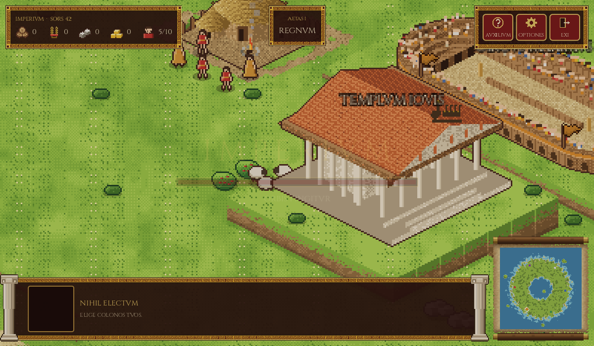
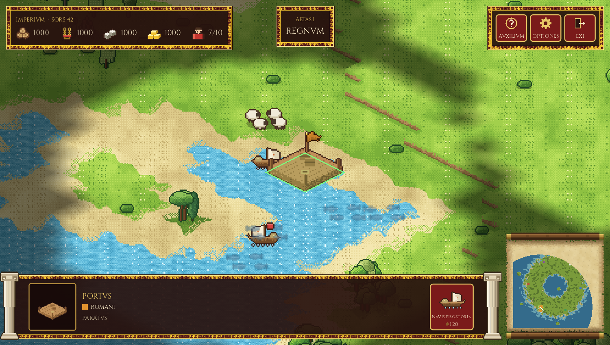
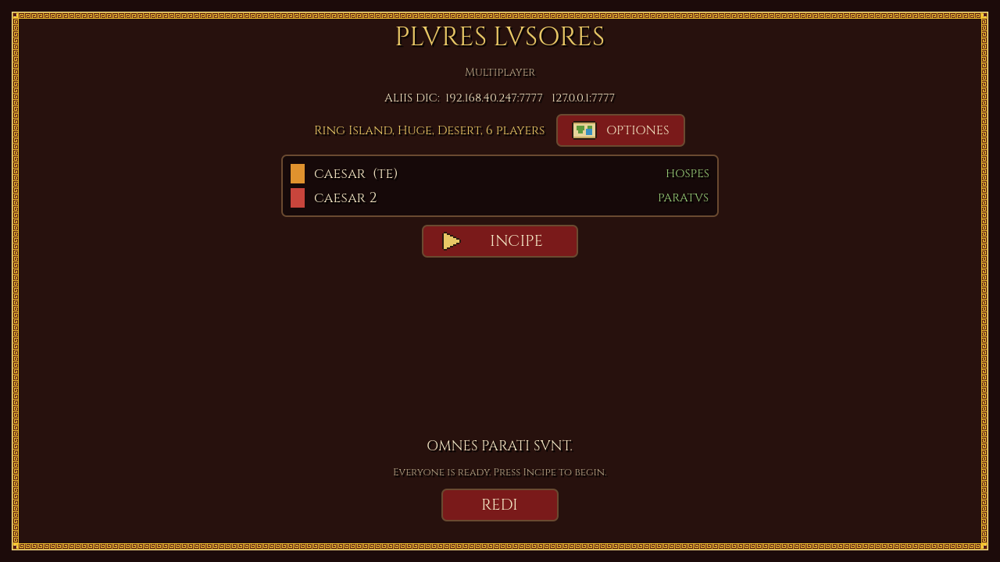

# IMPERIVM

A real-time strategy game about the rise of Rome, from a village of thatched huts on the Palatine to
the Empire. Isometric pixel art, Latin on screen, English on hover, and play in the spirit of Empire
Earth: gather, build, and advance through the eras. Written in Godot 4 (GDScript); every sprite is
drawn in code and baked into plain PNG sheets an artist can edit.


## A look at the game

**Choose your world.** The settings screen offers 18 kinds of map (plains, small and large islands, a
Mediterranean, a peninsula, a Tiber valley, highlands, marshes and more, each with a picture), five
map sizes, six kinds of ground (temperate, grassland, hilly, wooded, snowy and desert), two to eight
peoples (pick which peoples play and in what colors), three levels of resources and three levels of
computer skill, plus game speed, volume and screen mode. Everything is kept for next time. Land is
built by stamping shapes (continents, islands, ranges, lakes) onto the sea, so the maps read as places,
with open ground to build on. The AIs are computer-run and play by the same rules as you; they never
get free resources, on any setting.


**A village on the Palatine.** The Casa Romuli, the hut of Romulus, is your first town center. You start
with five citizens, no army and nothing in store: a couple of berry bushes and a herd of sheep by the
town are the first food, the woods the first wood, and everything else must be saved for. Its hearth
burns, the trees sway in the wind, and everything of yours flies the Roman purple.


**The Capitoline.** Near the city from the first moment stand two landmarks nobody owns: the Circus Maximus in the valley and the great Temple of Jupiter Optimus Maximus on a hill of its own, with its bronze quadriga on the roof. Neither can be built or burned.



**The Circus Maximus.** A landmark stadium stands in the valley near the city: four tiers of timber
seating, a sand track, a ring of arches round the base, and a crowd that cheers in waves.


**The Republic.** Advancing to Era II (*Res Publica*) changes the look of everything: the interface takes
a violet-and-white border, the hut of Romulus gives way to a marble Forum with a tiled roof, and
houses, vineyards, an aqueduct, the Senate House (*Curia*) and barracks become available.


**Towns grow.** You do not build new town centers: you build a **Settlement** beside land worth working,
and send villagers into it (**Incorpora**, key I). Each is absorbed for good as one of its citizens
(`Cives 23/50`). At 15 it becomes a Town Center, which makes villagers; at 30 a City Center, crowned with a
gilded tholos. **Farms** are nine tiles across: a granary framing eight plots, each worked by one villager
standing on it (it sows, grows and ripens by itself); eight citizens in the granary make a Large Farm. Herds
of sheep wander near the town and breed back slowly unless hunted out. At most six units work one deposit.

**The sea.** Schools of fish swim in the water near the coasts. A **Dock** is a pier in the shallows; it
makes fishing boats, which sail only on water, fish 15 at a time and bring the catch back to the dock.



**Many kinds of ground.** The ground is chosen apart from the shape of the land, so the same coast can
be green, snowy or sand. Snow whitens the grass, pines and hills; the desert parches them; marshlands
are reeds and pools; hilly maps rise into terraces; wooded maps are thick with forest. The minimap is a
parchment scroll that fills in as you explore.

| Snow | Desert |
|---|---|
|  |  |
| **Marshland** | **Hills** |
|  |  |


**Weather.** A slow chain of clear skies, cloud, fog, rain and storms rolls over the map. Rain
ripples the water, storms roughen it, and fog drifts in banks.


| Rain | Fog |
|---|---|
|  |  |

**Fighting men.** Horsemen (Equites), spearmen (Pedites) and slingers (Funditores) in the color of
their owner: purple for you, a different color for another player.


**Combat.** Fighting men fight each other and the computer-run peoples, who raise armies and send them
against you. The four kinds run in a circle: spearmen stop horsemen, horsemen ride down slingers,
slingers wear down heavy infantry from out of reach, and heavy infantry crush spearmen. Right-click an
enemy to attack it; after a kill a fighter goes after the next enemy nearby. A plain move order ignores
the enemy, so you can pull units back, and **A** then a click sends them attack-moving. Slingers shoot
from a distance, there are attack animations and health bars, and villagers run for the town when hurt.
Fighters attack enemy buildings too (right-click one): a building that falls to 40% health catches fire and burns down, leaving ash. A people is out when it has no Town Center and no villagers left, and the last one standing wins.


**The flight from Troy.** The game opens on a slowly rising Latin scroll, with the English beneath
each verse, over the burning city: Aeneas, the voyage, and the voice at the mouth of the Tiber.


**Multiplayer (lobby only so far).** *Plures* on the title screen opens a lobby where one player hosts and
the others join by the host's IP address. There is no server or lobby service: the host's computer is the
lobby. Everyone sees who has joined, the others press *Paratus* (ready), and the host picks the map and
presses *Incipe*; every computer then builds the same world from the host's seed. **The game itself is not
synchronized yet:** after the start each computer plays its own copy of that map, with no orders shared
between players. See [Multiplayer](#multiplayer) below.



## Features

- **Five eras** from the Kingdom (753 BC) to the Late Empire (476 AD); the buildings, their names
  and their look change as you advance. Era I is the most complete; the later ones are partly built (see the design notes).
- **Latin interface.** All text is in Roman capitals (V for U), with English on hover. The glossary
  is in [`docs/LATIN.md`](docs/LATIN.md).
- **A living world.** A map up to 480x480 with terraced hills, marsh, woods, mountains and coast; weather
  that changes; villagers who hide behind trees (and show through as a silhouette when they do).
- **Gathering and building.** Wood, food, stone and gold, taken from woods, berries, hunted herds, mines,
  farms and the sea; huts, houses, storehouses, Settlements that grow into towns, farms and vineyards,
  docks, a citadel, a stable and Vesta's shrine. The great Temple of Jupiter and the Circus Maximus stand near Rome from the start.
- **Computer players with goals.** Each AI explores with dogs, settles near stone and gold, farms and fishes,
  raises an army, advances an era and attacks; see [`docs/ARCHITECTURE.md`](docs/ARCHITECTURE.md).
- **Team colors** on buildings and units, one per player.
- **Multiplayer lobby** over a local network, the internet or one computer (host or join by IP); in-game
  sync is still to come.

## Running it

You need [Godot 4](https://godotengine.org) (`brew install --cask godot` on macOS).

```sh
./run.sh                 # play
./run.sh --seed=42       # a particular map
./run.sh --nosplash      # skip the opening scroll and title
# or use `just` (see justfile): just dev, just mp, just net-test, just shot out.png
just ai4                 # watch four AIs play each other, in four panes of one window
```

`just ai4` (`--spectate`) has no human player: four AIs play on one map and each pane shows the world as one of them sees it (its own fog of war, its own minimap), following it or the army it sends out. It uses temperate terrain; add `--terrain=snowy` (or another) to change it. Drag to look around, wheel to zoom, F to follow again, Q to quit. **`+` and `-` change the game speed** (1x to 32x; it starts at 1x, which is slow), or start faster with `just ai4 --speed=8`; add `--difficulty=difficilis` to make the AIs sharper.

The first run imports the project, which takes a moment. Other options include `--windowed`,
`--zoom=N`, `--weather=rain|fog|storm|cloudy|clear`, and `--shot=FILE` to save a screenshot. There is
a demo video in [`media/`](media/imperium-demo.mp4).

### Headless play and replays

The rules live in a `Simulation` that needs no window, so a whole game can be played in a terminal, written down, and played back exactly:

```
just sim 600 --seed=7 --out=game.replay    # four AIs play ten game minutes, as fast as the machine allows
just replay-check game.replay              # play it back with the AIs off; every checksum must match the original's
just replay game.replay --speed=8          # watch it in the window
```

A game played by a person is recorded with `./run.sh --replay-out=game.replay`. A replay holds the settings of the game and every command given (a few tens of kilobytes for ten minutes), and works because the simulation is deterministic: see [`docs/ARCHITECTURE.md`](docs/ARCHITECTURE.md).

### Multiplayer

Click *Plures* on the title screen, type a name, then either:

- **Exhibe** (host): opens a lobby on a port (default 7777, UDP). The lobby shows the addresses to give
  the others. Choose the map with *Optiones*, and press *Incipe* when everyone is *Paratus*.
- **Iunge** (join): enter the host's address and port, and press the button. Then press *Paratus*.

Which address to use:

| Where the players are | Address to join |
|---|---|
| Two copies on one computer (testing) | `127.0.0.1` |
| The same local network (LAN) | the host's LAN address, shown in the host's lobby (such as `192.168.x.x`) |
| Over the internet | the host's public IP. The host must forward UDP port 7777 on the router to their computer, and allow it through the firewall. |

macOS asks the host to allow incoming connections the first time. If a join times out, the usual causes
are a wrong address, a blocked port, or a missing port forward.

Try it on one computer with two copies: `just mp` (host and joiner, started together), or `just host` and
`just join` in two terminals. `just net-test` checks the networking without a window. The network code is
in `src/net/net_session.gd` and the lobby screen in `src/ui/lobby_screen.gd`.

### Controls

| | |
|---|---|
| Left click | select (drag for a box; double-click to select everything of that kind on screen; shift adds) |
| Right click | order: move, gather, build, drop off |
| Mouse at the edge of the screen | scroll the map |
| Wheel or pinch | zoom |
| X / S | explore / stop |
| Esc | cancel or clear the selection |
| W | step the weather (testing) |
| Q | quit |

## Where things are

| Folder | What is in it |
|---|---|
| `src/sim/` | the simulation: `simulation.gd` (the game loop), `state/` (units, buildings, the map, fog, the rules' tables) and `systems/` (movement, economy, combat, commands...). No scene or window; it runs headless and deterministically |
| `src/ai/` | the computer players |
| `src/replay/` | writing a game down as it is played, and playing it back |
| `src/ui/` | the UI for humans: the HUD and menus, `views/` (everything drawn from the game state: world, buildings, units, fog, weather) and `controls/` (mouse, keys, selection, camera) |
| `src/app/` | the scene root (`Main`, which also drives the ticks in play) and the debug scenes |
| `src/art/` | the drawing code that makes every sprite, and team colors |
| `src/ui/` | the HUD, buttons, the title screen, the multiplayer lobby and the opening scroll |
| `src/net/` | multiplayer: hosting, joining and the lobby's roster (`net_session.gd`) |
| `shaders/` | the ground, fog, weather and team-color shaders |
| `assets/` | the art sheets (PNG) and fonts |
| `docs/` | [`DESIGN.md`](docs/DESIGN.md) (game design and what is built), [`ARCHITECTURE.md`](docs/ARCHITECTURE.md) (technical design), [`LATIN.md`](docs/LATIN.md), [`PERFORMANCE.md`](docs/PERFORMANCE.md) |
| `src/infra/`, `src/audio/`, `src/text/` | settings and the profiler; music; the game's words (Latin and English) |
| `tools/` | `export_art.sh` regenerates the art sheets from the drawing code; `sim_run.gd` plays a whole game headless and writes it down, `replay_check.gd` plays one back and checks it; `lint.gd` and `check_members.py` check the scripts |
| `tests/` | the headless checks (`just *-test`, `just lint`); see `docs/ARCHITECTURE.md`, *Tests* |
| `justfile` | recipes for running, testing and screenshots (`just` lists them) |

See [`assets/art/README.md`](assets/art/README.md) for the art rules. Note that `tools/export_art.sh`
overwrites hand edits to the sheets.
