# IMPERIVM

A real-time strategy game about the rise of Rome, from a village of thatched huts on the Palatine to
the Empire. Isometric pixel art, Latin on screen, English on hover, and play in the spirit of Empire
Earth: gather, build, and advance through the eras. Written in Godot 4 (GDScript); every sprite is
drawn in code and baked into plain PNG sheets an artist can edit.

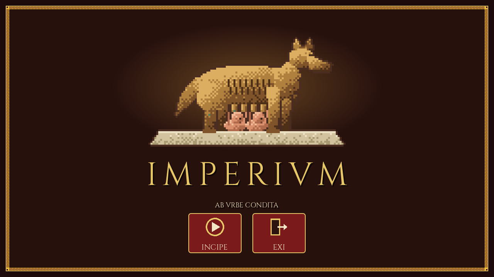

## A look at the game

**Choose your world.** The settings screen offers 18 kinds of map (plains, small and large islands, a
Mediterranean, a peninsula, a Tiber valley, highlands, marshes and more, each with a picture), five
map sizes, six kinds of ground (temperate, grassland, hilly, wooded, snowy and desert), two to eight
peoples (pick which peoples play and in what colors), three levels of resources and three levels of
computer skill, plus game speed, volume and screen mode. Everything is kept for next time. Land is
built by stamping shapes (continents, islands, ranges, lakes) onto the sea, so the maps read as places,
with open ground to build on. The rivals are computer-run and play by the same rules as you; they never
get free resources, on any setting.

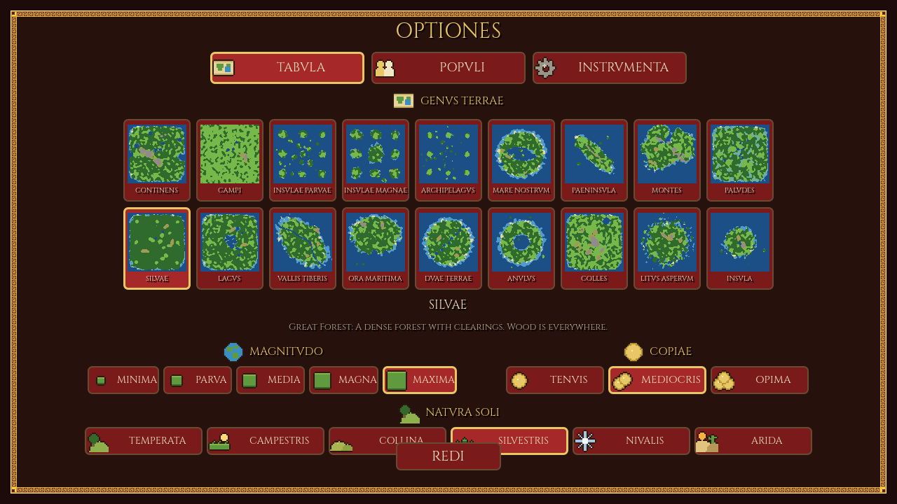

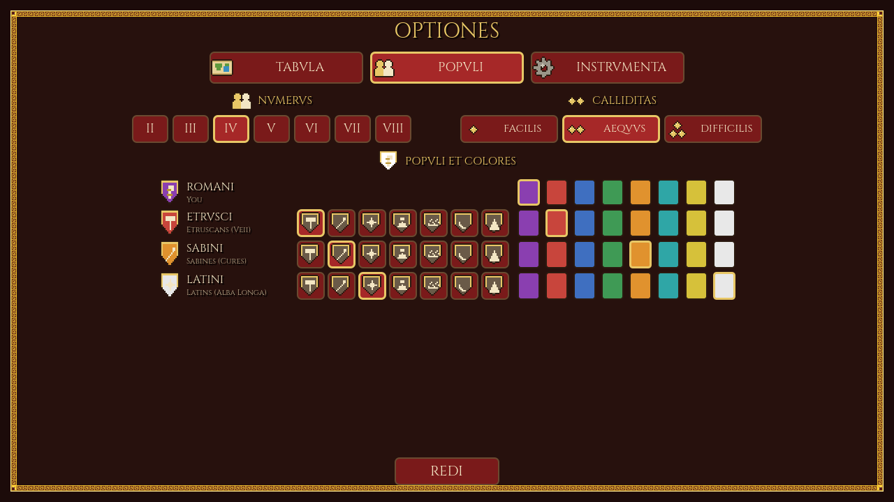

**A village on the Palatine.** The Casa Romuli, the hut of Romulus, is your first town center. Its
hearth burns, the trees sway in the wind, and everything of yours flies the Roman purple.

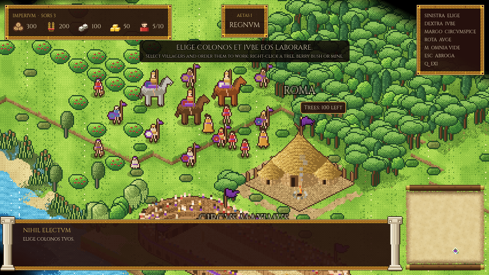

**The Circus Maximus.** A landmark stadium stands in the valley near the city: four tiers of timber
seating, a sand track, a ring of arches round the base, and a crowd that cheers in waves.

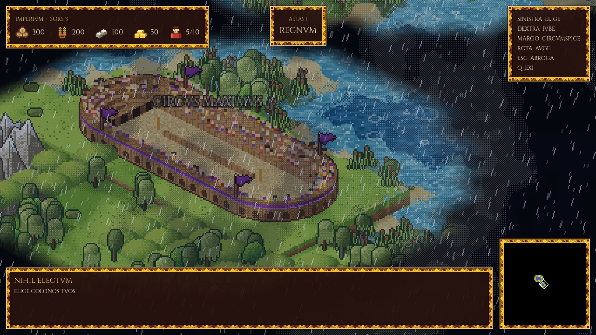

**The Republic.** Advancing to Era II (*Res Publica*) changes the look of everything: the interface takes
a violet-and-white border, the hut of Romulus gives way to a marble Forum with a tiled roof, and
houses, vineyards, an aqueduct, the Senate House (*Curia*) and barracks become available.

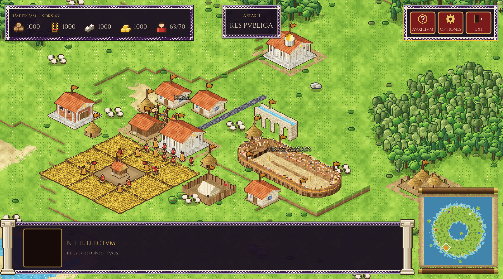

**Many kinds of ground.** The ground is chosen apart from the shape of the land, so the same coast can
be green, snowy or sand. Snow whitens the grass, pines and hills; the desert parches them; marshlands
are reeds and pools; hilly maps rise into terraces; wooded maps are thick with forest. The minimap is a
parchment scroll that fills in as you explore.

| Snow | Desert |
|---|---|
| 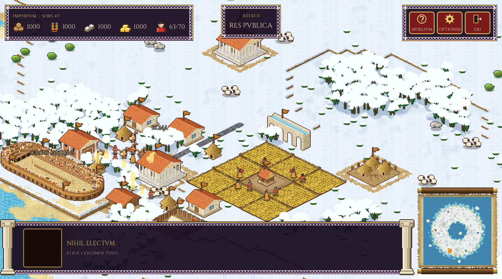 | 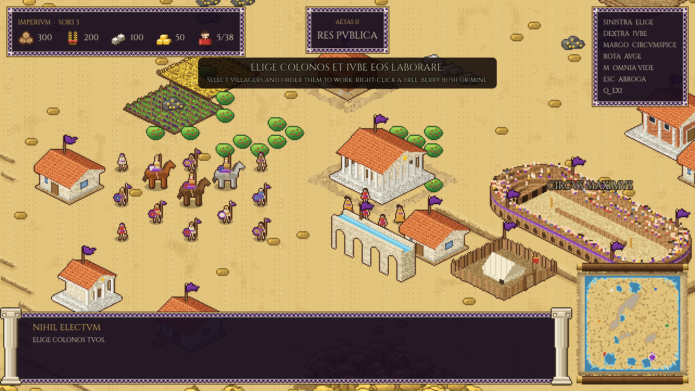 |
| **Marshland** | **Hills** |
| 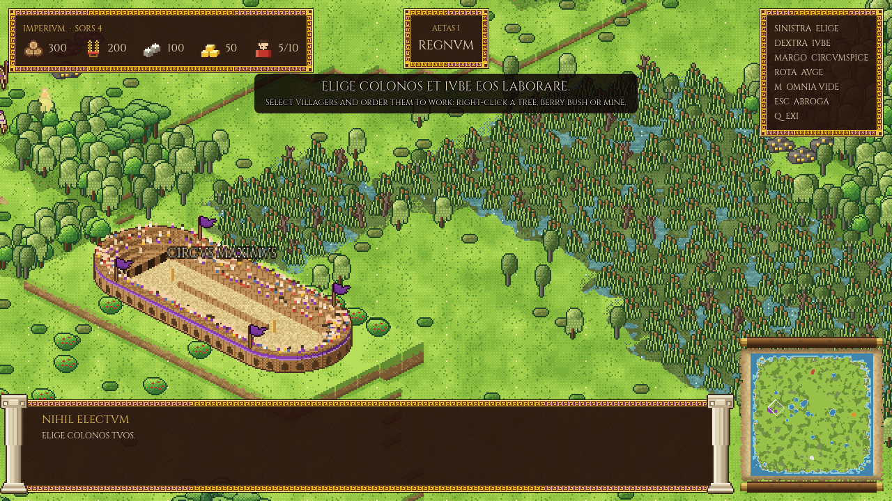 | 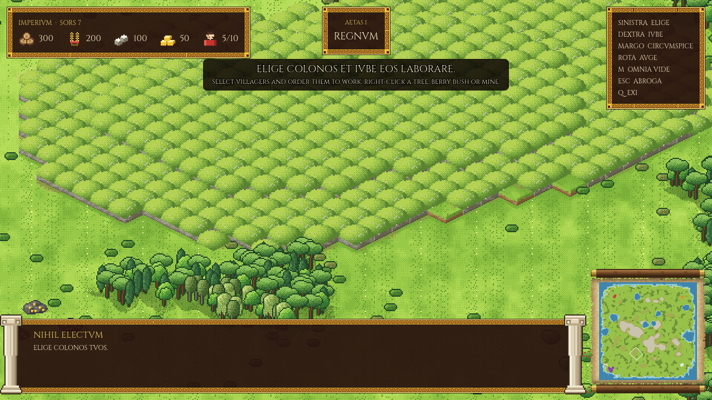 |

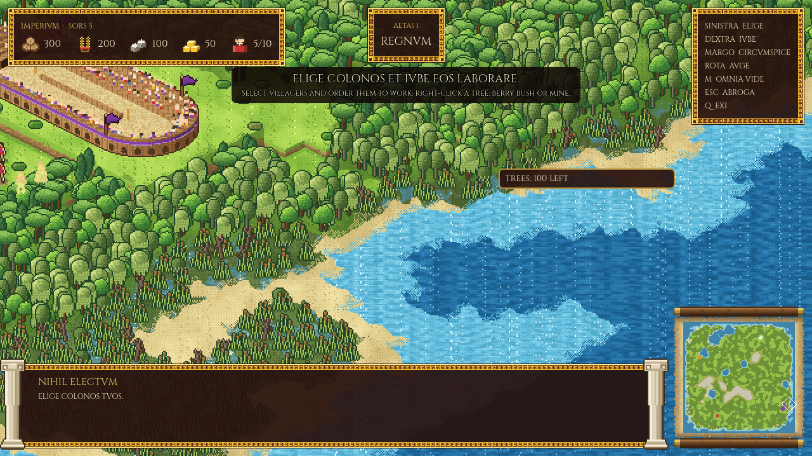

**Weather.** A slow chain of clear skies, cloud, fog, rain and storms rolls over the map. Rain
ripples the water, storms roughen it, and fog drifts in banks.

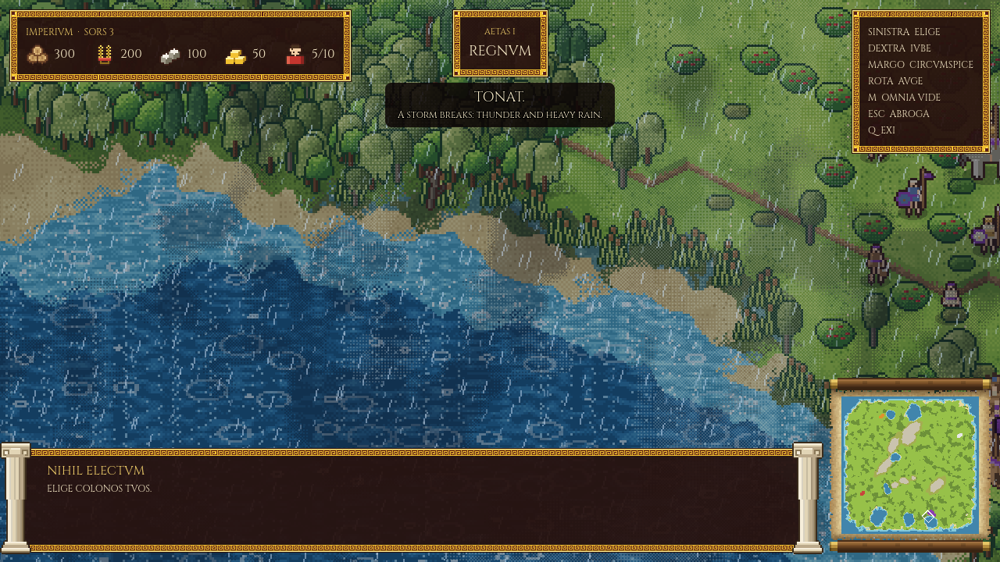

| Rain | Fog |
|---|---|
| 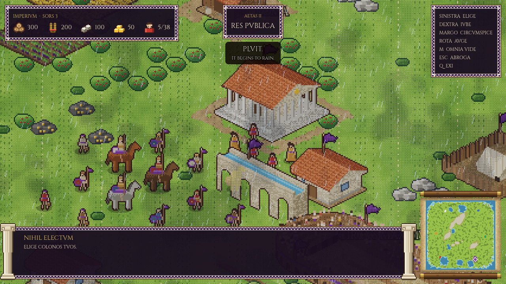 | 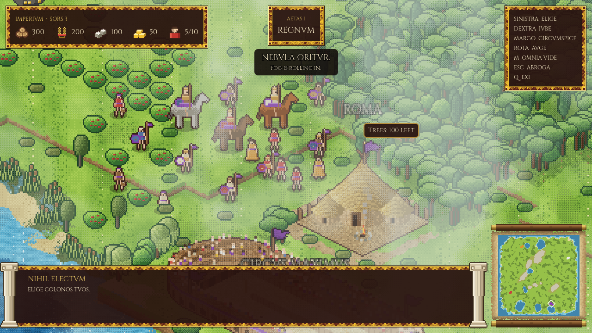 |

**Fighting men.** Horsemen (Equites), spearmen (Pedites) and slingers (Funditores) in the color of
their owner: purple for you, a different color for another player.

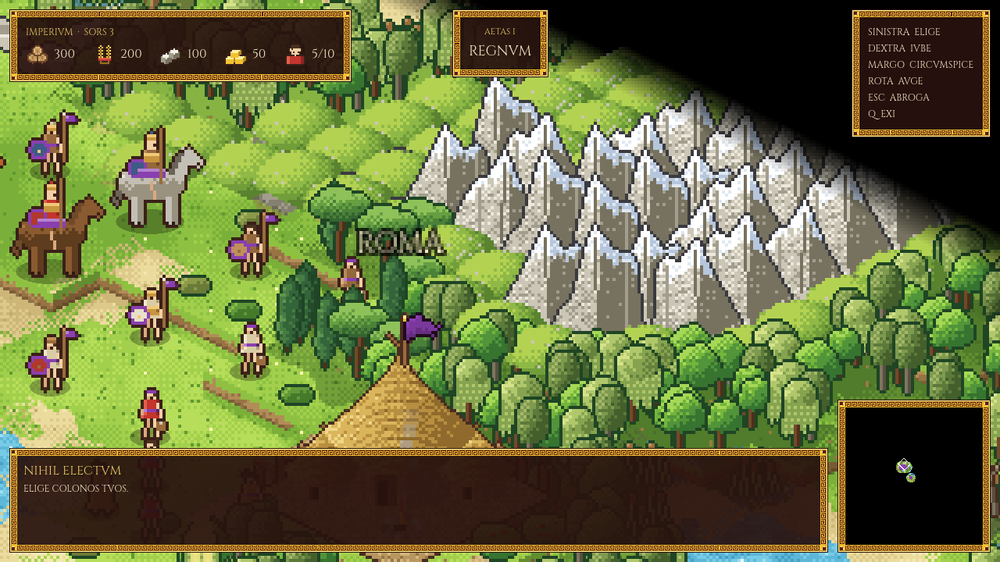

**Combat.** Fighting men fight each other and the computer-run peoples, who raise armies and send them
against you. The four kinds run in a circle: spearmen stop horsemen, horsemen ride down slingers,
slingers wear down heavy infantry from out of reach, and heavy infantry crush spearmen. Right-click an
enemy to attack it; after a kill a fighter goes after the next enemy nearby. A plain move order ignores
the enemy, so you can pull units back, and **A** then a click sends them attack-moving. Slingers shoot
from a distance, there are attack animations and health bars, and villagers run for the town when hurt.
Buildings cannot be attacked yet.

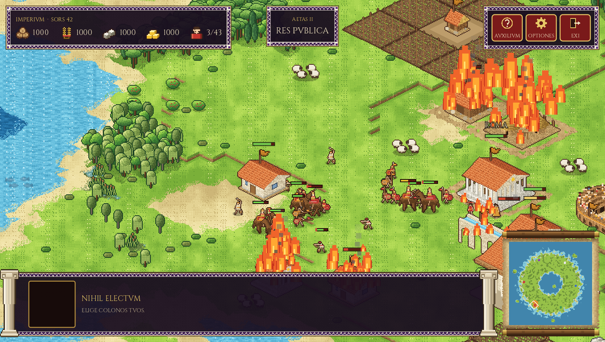

**The flight from Troy.** The game opens on a slowly rising Latin scroll, with the English beneath
each verse, over the burning city: Aeneas, the voyage, and the voice at the mouth of the Tiber.

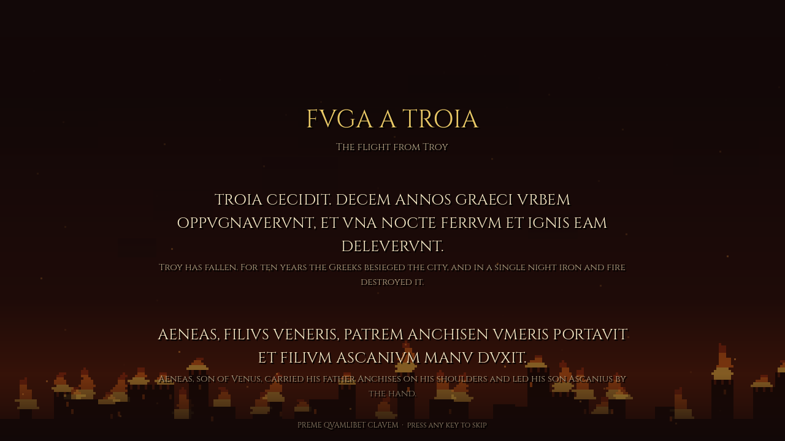

## Features

- **Five eras** from the Kingdom (753 BC) to the Late Empire (476 AD); the buildings, their names
  and their look change as you advance. Era I is the most complete; the later ones are partly built (see the design notes).
- **Latin interface.** All text is in Roman capitals (V for U), with English on hover. The glossary
  is in [`docs/LATIN.md`](docs/LATIN.md).
- **A living world.** A map up to 480x480 with terraced hills, marsh, woods, mountains and coast; weather
  that changes; villagers who hide behind trees (and show through as a silhouette when they do).
- **Gathering and building.** Wood, food, stone and gold; huts, fields, granaries, a citadel, a
  stable and Vesta's shrine.
- **Team colors** on buildings and units, ready for a second player.

## Running it

You need [Godot 4](https://godotengine.org) (`brew install --cask godot` on macOS).

```sh
./run.sh                 # play
./run.sh --seed=42       # a particular map
./run.sh --nosplash      # skip the opening scroll and title
# or use `just` (see justfile): just dev, just mp, just net-test, just shot out.png
```

The first run imports the project, which takes a moment. Other options include `--windowed`,
`--zoom=N`, `--weather=rain|fog|storm|cloudy|clear`, and `--shot=FILE` to save a screenshot. There is
a demo video in [`media/`](media/imperium-demo.mp4).

### Controls

| | |
|---|---|
| Left click | select (drag for a box; double-click to select everything of that kind on screen; shift adds) |
| Right click | order: move, gather, build, drop off |
| Mouse at the edge of the screen | scroll the map |
| Wheel or pinch | zoom |
| X / S | explore / stop |
| Esc | cancel or clear the selection |
| W | step the weather (testing) |
| Q | quit |

## Where things are

| Folder | What is in it |
|---|---|
| `core/` | game state and rules: the map, units, buildings, weather, fog |
| `art/` | the drawing code that makes every sprite, and team colors |
| `views/` | everything drawn from the game state: world, buildings, units, fog, weather |
| `ui/` | the HUD, buttons, the title screen and the opening scroll |
| `shaders/` | the ground, fog, weather and team-color shaders |
| `assets/` | the art sheets (PNG) and fonts |
| `docs/` | [`DESIGN.md`](docs/DESIGN.md) (design notes and what is built) and [`LATIN.md`](docs/LATIN.md) |
| `tools/` | `export_art.sh` regenerates the art sheets from the drawing code |

See [`assets/art/README.md`](assets/art/README.md) for the art rules. Note that `tools/export_art.sh`
overwrites hand edits to the sheets.
