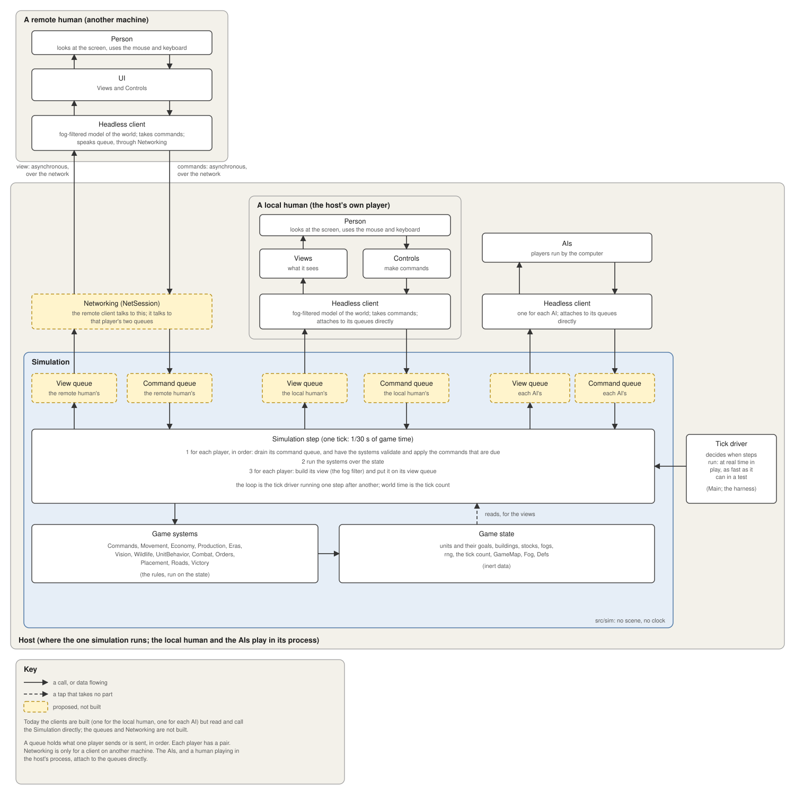

# IMPERIVM — architecture

How the code is put together. For what the game is and what is built, see [`DESIGN.md`](DESIGN.md).

Status key as in DESIGN.md: **built**, **decided**, **proposed**, **open**.

---

## Layout

Code is under `src/`; Godot has no required layout, and scripts find each other by `class_name`, so files
can move between folders freely. Only `res://` paths (the scene, shaders, assets) name locations.

The folders follow the diagram below. Each box in it is named in the table after the layout, with where it is
in the code, or marked as not built.

| Folder | Role |
|---|---|
| `src/sim/` | **The simulation**: everything that decides what happens, and nothing that shows it. No scene, no window, no input, no clock. At the top, `Simulation` (`step()`, and the owner of the parts), `SimConfig` (the choices that shape a game), the queues that are its interface (`CommandQueue`, and `ViewQueue` with `ViewFilter`, the fog, and `ViewFrame`, what is put on it) and the world the rules are run on (`RulesWorld`, `SimWorld`). |
| `src/sim/state/` | The **game state**, inert data: `Unit`, `Building`, `Deposit`, `GameMap` and `TerrainGen` (the ground), `Fog` (what each people has seen), and `Defs` (the rules' tables: five resources, wood, food, stone, gold and iron). |
| `src/sim/systems/` | The **game systems**, which act on the state: `Commands`, `Orders`, `Movement` (with `UnitGrid`), `Economy`, `Production`, `Eras`, `Vision`, `Wildlife`, `Climate`, `UnitBehavior`, `Combat`, `Placement`, `Roads` (whose rules, `Placement.check` and `Roads.check`, are run on a `RulesWorld`), `Victory`, `WorldSetup`. |
| `src/client/` | The **headless client**: `ClientLink` (where a client's views come from and its commands go: `LocalLink` for the host's own process, `NetLink` for the network), `HeadlessClient` (a player's end of the queues, with no screen: a way to act, and the latest view), `PlayerView` (that view, and questions about it: what the player may know, the news that concerns it, and where things may be built), `ClientMap` (the ground it has been told of), `ClientWorld` (what the rules are run on, on the client), `UnitInfo` and `BuildingInfo` (a unit or building as the client knows it: kept up to date, carrying the client's own marks, selection included). A *god* view (`PlayerView.god`) knows everything, for a spectator. |
| `src/host/` | `Host`: the one `Simulation` and the AIs beside it. It founds the players, gives each computer-run people its `AI` and a headless client, and its `step` is what the tick driver calls: the AIs think (they put commands on the queue), then the Simulation steps. |
| `src/ai/` | The computer players: `AI` and one class per goal. They read the game only through a `PlayerView` and act only through a `HeadlessClient`. See *The AIs*. |
| `src/replay/` | `Replay` (the file), `Recorder`, `Replayer`. See *Headless play and replays*. |
| `src/ui/` | **The UI, for humans only**: the HUD, menus, lobby, title and opening scroll. Nothing under `src/ui/` names the simulation (`tools/check_members.py` fails if it does): it reads `game.view` and acts through `game.client`. |
| `src/ui/views/` | Drawing the state: `World` and the unit, building, ground, fog, weather and overlay views, the minimap, `Iso` (tile and screen maths), `Weather` (cosmetic). Read the simulation, never change it. |
| `src/ui/controls/` | `Person` (mouse, keys, selection, command targeting) and `CameraRig`. |
| `src/app/` | The application: `Main` (starts the world, wires the parts, and is the **tick driver** in play) and the debug scaffolding (`DebugModes`, `EraPreview`). |
| `src/net/` | Networking: `NetSession` (the lobby: hosting, joining, the roster, starting the game), `NetPlay` (the game in play: carries the two queues between the host and each remote player) and `NetLink` (a remote player's `ClientLink`). |
| `src/art/` | Sprite drawing code; baked into PNG sheets by `tools/`. |
| `src/infra/` | `GameSettings` (what the player chose; kept in `user://settings.cfg`) and `Perf` (the profiler). |
| `src/audio/`, `src/text/` | `Music`; `Phrases` and `Latin` (the game's words). |
| `tools/` | Headless runners and dev tools (`sim_run` is the headless tick driver; `replay_check`, `lint`, art export). |
| `tests/` | The headless checks, one script each (`just commands-test`, `just replay-test`...). |

### From the diagram to the code

| Box in the diagram | In the code |
|---|---|
| Person | the person |
| UI | its two halves, below: Views (what the person sees) and Controls (what the person does) |
| Views | `src/ui/views/`, and the HUD's readouts in `src/ui/`; they draw `game.view` (a `PlayerView`) |
| Controls | `src/ui/controls/` (`Person`, `CameraRig`), and the HUD's buttons in `src/ui/`; commands go through `game.client` |
| AIs | `src/ai/`, run by the `Host` (`src/host/host.gd`) between one step and the next; the Simulation knows nothing of them |
| Headless client (a local human's, inside the UI) | `src/client/`, made once in `Main` (`Main.client`, `Main.view`); built. It takes its views from its view queue and runs the rules on its own picture (`PlayerView.placement_error`, `find_site`...) |
| Headless client (a remote human's, on another machine) | `src/client/`, made in `Main` on a remote player's machine (`Main.remote`) with a `NetLink` for its link; built: the same client, with no `Simulation` at all, speaking queue through Networking |
| Headless client (the AIs') | `src/client/`, made for each AI in `WorldSetup` (`AI.client`, `AI.view`); built, as above |
| Networking | `NetPlay` (`src/net/net_play.gd`), under the `NetSession` on every machine; built. On the host it puts a remote player's commands on the command queue (the connection says who, never the command), sends back the answer to each, and sends each tick's view of that player; on a remote player's machine it hands the views and answers to its `NetLink`. Frames are serialized (`ViewFrame.to_bytes`), compressed and sent on a reliable channel (ENet, over UDP) |
| Command queue (one for all) | `CommandQueue` (`src/sim/command_queue.gd`), held as `Simulation.command_queue`; built. A client's `submit` puts a command on it with the player and the due tick; `Simulation.step()` drains it first thing, in (tick, player, order given) order, and each answer comes back as `Simulation.answered` (the client's `answered`) |
| View queue (one for each player; it also carries the fog and the ground, see *Map and fog*) | `ViewQueue` (`src/sim/view_queue.gd`), opened with `Simulation.open_view`; built. The step builds a view at its end for each queue that is due (`ViewFilter`, `src/sim/view_filter.gd`: the one place the fog is applied; a `ViewFrame`, `src/sim/view_frame.gd`: plain data, with its events), and the queue keeps only the latest, folding in any it had not read. The client's `PlayerView.refresh` takes it. A person's client asks for one every tick; an AI asks, a tick ahead, when it is about to look (`HeadlessClient.want_view`) |
| Simulation step | `Simulation.step()` in `src/sim/simulation.gd`: drains the command queue, runs the systems, and puts the views that are due on the view queues |
| Game state | `GameState` (`src/sim/state/game_state.gd`), held as `Simulation.state`: the map, units, buildings, stocks, fogs, tick, rng, eras, road plans, shots in flight, who has fallen. Inert; see *Known debts* for what is still not |
| Game systems | `src/sim/systems/`: they hold no game state of their own (only the `Movement` grid, which is rebuilt each tick). Their rules for where things may go (`Placement.check`, `Roads.check`) are static, run on a `RulesWorld`: the engine's (`SimWorld`) at the drain, a client's (`ClientWorld`) for instant answers |
| Tick driver | `Main._run_sim` (`src/app/main.gd`), which calls `Host.step`; `tools/sim_run.gd` (`Host.step`) and `tools/replay_check.gd` (`Simulation.step`, nothing beside it) headless |

### How the parts depend on each other

The simulation depends on none of the client: it tells the client what happened through signals, and the client
reads its state to draw it.



*The key is in the picture. The client is `Views` (the world, the minimap, the HUD's readouts) and `Controls` (the mouse
and keys, which `Person` handles, and the buttons); yellow boxes are proposed, not built.*

**The design (the picture above).** Everything in it is built. It is how the parts fit:

- **A headless client per player, human or AI.** It is the player's end of the queues: it sends their commands, holds the latest view it was sent (already
  filtered by the step) and answers questions about it. A human's client is part of the UI: `Views` and `Controls` (with `Person` as the thing that handles the mouse
  and keys) are wrapped round it. Each AI has a client of its own, the same class, in the AIs' part of the picture. Each client attaches to the
  queues. So a human and an AI see and do exactly the same things, and neither can look at the real state: nothing a client reads comes
  from the `Simulation` but its own frames (a spectator's god view, which reads the real ground, is the one exception).
- **The AIs run in the host**, in the game server's process, beside the Simulation and not in it (`Host`): in principle an AI could run elsewhere and
  talk to the host as a person's client does, but the usual deployment is in the server. Each has its own headless client, and the host only
  gives it the time to think, between one step and the next.
- **The simulation's interface is queues.** Each player has a *view queue* (what it is sent); there is one *command queue*
  for everyone. A client, human or AI, attaches to them directly; that is all it speaks. Views are per player because each
  player may see only part of the world: the step filters the state for each player and puts the result on that player's
  queue, so what is on a queue is already what that player may know, and no queue holds the whole state. A view queue keeps only the
  player's *latest* view, so a slow reader (an AI that acts once a second) skips what it missed (a frame that was not read is folded into the
  next, so no news is lost). Commands share a queue because only their order within one player matters. Each carries its player, which the host
  side sets (Networking from the connection, never from what a remote client claims), and the tick it is due: the next tick for a live command, an
  agreed one for a lockstep peer's. That is where an inherently asynchronous world meets a simulation that consumes input at fixed ticks, and the
  one place where the nondeterminism ends: what is drained, in what order, is what the game is made of.
- **Networking is only a wrapper (`NetPlay`).** A client on another machine talks to a Networking box (`NetSession`), which talks to the
  command queue and its player's view queue. The AIs, and a person playing in the host's own process, attach to the queues directly. There are no
  separate receiver, publisher or channel components.
- **The simulation step is where it all happens**, and *the loop* is the tick driver running one step after another. A step:
  **(1)** drain the command queue: the game systems validate and apply the commands that
  are due, in player order (two players' commands for the same tick can compete for a tile or for stock, so the order is a rule, not arrival order), each for its player; **(2)** run the systems over the **game state**, which is what makes the world move with nobody issuing
  anything (a fire burns down, a dog walks towards its goal); **(3)** for each player whose view is due, build it (this is where the
  fog filter is: a view is made from what that player may know) and put it on its view queue. The **game state** is inert
  data and the **game systems** act on it, a little like a rules engine. The clock reaches the world through the step, and
  commands reach it through the drain.
- **The rules run on the client too.** A screen wants to know at once whether a house may go under the mouse, and an AI whether a site is
  good, so the client asks the same rules the engine runs (`Placement.check`, `Roads.check`, `GameMap.find_site`, `Movement.unit_speed`) on its own
  picture of the world, through a `RulesWorld`: the engine's `SimWorld` or the client's `ClientWorld` (the `ClientMap` it was told of, its fog, the
  buildings and people it knows of, its own store). That is prediction, nothing more: the engine still checks every command when it drains it, with
  all of the truth, and its answer comes back as the command's (`answered`). Where the two differ, the client's picture is out of date (ground out
  of sight that has since changed, a person it cannot see in the way) and the engine's answer is the one that counts. `tests/map_view_test.gd` checks
  that on what a client can see the two agree.
- **The tick driver is the only thing that connects game time to real time.** The simulation has no clock of its own: it has a
  tick counter that goes up by one inside each step, and a tick is always 1/30 s of game time. Whatever calls `step()` decides
  when and how often: `Main` in play (it banks real time, runs a step per 1/30 s of it, more per frame when fast-forwarding, none
  when paused; the screen's view is built once, after the last tick of the frame); a test or the headless runner in a tight loop, for exactly N
  ticks and as fast as the machine allows; and in lockstep play, later, it would also wait until every player's commands for the next tick have
  arrived. The driver never sets the clock, it only asks for steps, and the tick size never changes, so a game plays out the same whichever
  driver runs it.
- **Recording and replaying are not part of this design.** There are tools for them (`src/replay/`, see *Headless play and
  replays*), built on the command layer and the checksum, and they attach to the queues; the design leaves room for them
  (commands are stamped with a due tick, and what is drained is what the game is made of) but does not depend on them.

**Map and fog (built).** A client is told of the ground and the fog as it explores, never the whole map and never the seed. The first frame
tells the size of the map; after that each frame carries the fog's changes (`Fog` keeps a log of them for each reader), and the ground and
deposits (`ViewFrame.ground`, `deposits`) of the tiles that are newly explored, or that changed where the client can see (`GameMap.touch` logs
the changes, and `ViewFilter` tells a client of one on a tile in sight at once, and of one out of sight when it is next seen). The client keeps
what it is told in a `ClientMap` (a `GameMap` filled in tile by tile, `known` says which) and a `Fog` that keeps a picture of itself if it is
to be drawn. The views redraw what is newly known (`PlayerView.ground_changed`). `tests/map_view_test.gd` checks that a client knows exactly
what it has explored, is up to date where it sees, and has nothing of the rest. A spectator's god view reads the real ground.

What this costs. A command gets no answer at once: the `Controls` flash a refusal when it comes back (a step later), and an AI, which cannot
wait, counts what it has put on the queue as spent and takes a refusal as a callback. A client that is told of the ground and the fog as it
explores has to be kept in step with the engine: every frame is authoritative and overwrites the client's picture, and a client that has fallen
behind or out of step (a gap in the frames, a view that does not hash as the engine's does) would ask for a full snapshot, which is still to be built
(see *Known debts*). And the host has to deliver each tick's updates to every client and collect their commands in a fixed order (by player),
inside the tick boundary, so that an AI reacts a tick late.

## Players, drivers and commands  (**built**)

The central rule: **a player acts on the game only by putting a command on the queue, and the game cannot tell who
put it there.**

```
 person (mouse, keys, selection)  ─┐
 AI (computer player)          ─┼─►  client.submit(cmd) ─► CommandQueue ─► step: Commands.apply(cmd) ─► game state
 replay (a recorded game)      ─┤                                            validate · pay · apply
 remote peer (network)  [decided] ─┤
 test script                   ─┘
```

- **Game state** is the `Simulation`'s units, buildings, map, per-player `stocks` and `fogs` (both indexed by
  owner). A player is just an owner number; the simulation has no notion of a "local" player. (`Main.LOCAL`
  is the player at this keyboard, and only the client knows it.)
- **A command** is a plain `Dictionary` of numbers, strings and tiles, with `type` and `owner`; units and
  buildings are named by `id` (`Unit.id`, `Building.id`), never by reference. That makes a command
  serializable, so it can be sent over the network, recorded, or written by hand in a test. The set of
  commands and their fields is listed at the top of `src/sim/commands.gd`.
- **`Commands.apply(cmd) -> String`** is the only gate, and the step is the only thing that calls it, once for each command
  drained from the queue (a test that wants an answer at once may call it itself). It checks that the named units and buildings exist
  and belong to `owner` (anything else is trimmed away), checks the rules (affordable, population room,
  placement, era), pays, and applies. It returns `""` on success or a phrase key on refusal (`"err.cant_afford"`; see *Text*), and it never
  touches the selection, mouse, HUD or markers. It emits `applied(cmd, err)` for everything it is given: that is how
  a game is recorded. The answer goes back to the client as `Simulation.answered(ticket, cmd, err)`, a step after the question at the soonest.
- **The queue** (`CommandQueue`) takes a command with the player who gave it and the tick it is due, which the host side sets
  (`HeadlessClient.submit` puts its own owner in whatever the command says). The step drains what is due at its start, by due tick, then player,
  then the order each gave them, so that two players' commands for the same tick are settled the same way whichever arrived first.
- **Drivers** decide what to ask for:
  - The person's driver is `Person` (`src/ui/controls/person.gd`). It turns clicks and the selection into commands, flashes a refusal, and keeps
    purely interface state (markers, placement mode, attack-move mode) to itself.
  - `AI` (`src/ai/ai.gd`, see *The AIs* below) thinks about once a second and puts commands on the queue as its owner through its
    own `do` (it does not wait for the answer: `do` can be given what to do if the command is refused, and `spend` counts what it has put
    on the queue as spent until the store shows it). It sees the world only through its client's view, so it knows only what its people have seen.
  - `Replayer` puts the commands a recording holds on the queue, due at the ticks they were given.
- **What is not a command.** Things the simulation does on its own are not player intent and call the order
  functions directly: a gatherer finding a new tree, a fighter picking a fight (`Combat`), a builder
  finishing and going idle. Scripted setup and the `--showcase`/`--demo` debug modes also place and order
  things directly; that changes the game without a command, so a game played with them cannot be replayed (see `taint` below).
- **What the simulation says back** is views and answers, never calls. Each frame on a player's view queue carries the world as that player
  may know it and what has happened to it (`notice`, `building_completed`, `era_reached`, `people_fell`, `game_won`: the `PlayerView` turns them
  back into signals for `Main` to show), and each command's answer comes back as `answered`. Inside the simulation these are still signals
  (`Simulation.notice` and the rest), which the `ViewFilter` collects for each player.

Adding a new action: add a branch in `Commands.apply` and a line in its header comment, make `Person`
and (if the AI needs it) `AI` call it, and add a case to `tests/commands_test.gd`.

## Time and determinism  (**built**)

`Simulation.step()` moves the game on by exactly one **tick**, 1/30 second of game time, whatever the frame
rate. `Main` keeps a running total of real time (already scaled by the game speed) and takes as many ticks as
it holds; the views draw units a fraction of the way between where they stood at the start of the last tick
and where they stand now (`Unit.prev_pos`, `Main.sim_alpha()`), so motion stays smooth at 60 frames a second.
A headless run just calls `step()` as fast as it can.

**The clock.** World time is only the tick count (`Simulation.time()` is `tick x 1/30 s`); the simulation never reads the wall
clock. A *tick driver* outside it decides how many ticks to run for a slice of real time: `Main` in play (one tick
per 1/30 s, more when fast-forwarding, none when paused), the headless runner as fast as it can, `Replayer` up to the
recording's last tick. The size of a tick never changes, so "twice as fast" is twice as many ticks, never bigger steps.

The simulation is **deterministic**: given the same `SimConfig` (the seed and the choices that shape the
world) and the same commands at the same ticks, it plays out the same, tick for tick. That is what makes
replays possible, and it is what lockstep multiplayer will need. It holds because of these rules, which any
change to `src/sim/` and `src/ai/` has to keep:

- **Randomness** comes only from seeded generators: the map's (`TerrainGen`, `GameMap`), the rules' (`Simulation.rng`,
  used by `Wildlife`), and one for each AI (`AI.rng`). The AI's is separate on purpose: an AI's decisions end up in the
  record as commands, so a replay (which has no AIs) must not depend on the dice they rolled. No `randf()`, `randi()`
  or `shuffle()` on the global generator, anywhere in the simulation.
- **No wall clock, frame rate, window, input, scene tree or settings screen.** The simulation reads `Defs` and the
  option tables of `GameSettings`, never the player's saved choices: those reach it only through `SimConfig`.
- **Numbers are per simulation, not global.** Unit and building ids, the eras, the town names all belong to one
  `Simulation`, so two can run in one process (`tests/replay_test.gd` does) and a replay's ids match the original's.
- **Commands are drained at the start of a step**, in the queue's order (due tick, player, the order given).
  `Replayer` puts a recording's commands on the queue at the same ticks, so a command always sees the same game.
- **Everything the player should hear or see is in its view.** The simulation never calls the HUD.

`Simulation.checksum()` is a SHA-256 of the whole game as it stands (tick, rng state, stocks, eras, every unit and
building with its position and health, every deposit, every fog). Two games that have played the same have the
same checksum. It is exact to the bit, so it also demonstrates that the arithmetic repeats; this is verified on one
machine and one build of Godot, and not across platforms.

Where the nondeterminism is: when a command *arrives* (the network, the AIs' timing) is up to the world. What the
simulation does with it is not, once it is drained from the command queue at the start of a step in a fixed order (due tick,
player, the order each gave them). Recording the drained sequence (each command with the tick it was applied at) therefore pins
the game down, whatever order things arrived in.

Two things change the game *without* a command, and so are not replayable: the debug aids (`M` lays the map open,
`E` jumps through the eras, and the scene flags `--town`, `--demo`, `--skirmish`...). They call `Simulation.taint(why)`;
a recording notes it, and a replay that then strays says why.

## Headless play and replays  (**built**)

```
just sim 600 --seed=7 --out=game.replay      # a whole game of AIs, no window, as fast as the machine allows
just replay-check game.replay                # play it back with the AIs off; every checksum must match
just replay game.replay --speed=8            # watch it in the window (nothing is played: the commands come from the file)
just replay-test                             # determinism and replay checks (tests/replay_test.gd)
just lint                                    # parse every script and check every member named on the simulation exists
```

`tools/sim_run.gd` builds a `SimConfig` from its flags (never from the saved settings), a `GameMap` and a
`Simulation` with no human player, attaches a `Recorder`, and calls `step()` in a loop. Nothing of the client
is loaded. `tools/replay_check.gd` is the same with a `Replayer` in place of the AIs. A small game runs at
around 8 to 25 times real time; the cost is mostly units steering round one another (see *Known debts*).

A game played by a person is recorded the same way: `./run.sh --replay-out=game.replay` writes the commands
the person and the AIs give and a checksum every five seconds, and the file is good even if the game is quit
part way. `./run.sh --replay=game.replay` plays it back in the window with the same views and interface as a
live game (input is switched off) and prints whether it held when it ends.

The file (`src/replay/replay.gd` has the details) is text, one record to a line:

```
IMPERIVM-REPLAY 2
["head", {"config": {"seed": 3, "map_type": "continens", ...}, "view": {"colors": [...]}, ...}]
["cmd", 0, {"owner": 1,"tile": Vector2i(33, 39),"type": "gather","units": [6]}, ""]   tick, command, the game's answer
["chk", 150, "5f0c9a77e8d2b413"]                                                      tick, checksum
["end", 18000, "d2f74fa69bea350e"]
```

A replay is a few tens of kilobytes for ten game minutes. It records what was *decided*, not what happened, so
it is small and stays valid when the code that carries commands out is fixed, as long as the fix is not meant to
change what happens: when it is, old recordings stop matching (a checksum differs), and that is the point of them.

## Multiplayer  (**built**)

`NetSession` (`src/net/net_session.gd`, ENet and RPC, a node at `/root/NetSession`) runs the lobby: hosting, joining, the roster, ready flags,
and handing everyone the host's settings and their place in the game (the host is player 0, the rest follow in the order they joined). The
others are **not** told the seed: they do not build the world.

When the host starts the game, `Main` on the host builds the world and the AIs (a `Host`), makes a headless client for its own person as before,
and attaches `NetPlay`, which opens a view queue for each remote player and listens for their commands. Every other machine runs `Main` as a **remote
player** (`Main.remote`): no `Simulation`, no map, no AIs; its client has a `NetLink`, so its commands go to the host and what comes back is its views
(the first says how big the world is and where its town stands; after that the ground, the fog, its people and what it can see of the others') and the
answers to its commands. Everything else is as for a person on the host: the same `PlayerView`, the same views and controls, the same rules run on the
client's own picture. If a remote player leaves, an AI takes over its people.

```
just mp                  # two windows on this machine, over 127.0.0.1: the host starts when the joiner is ready
just host / just join <address>      # two machines on a LAN: the address is the one the host's lobby shows
just net-play-test       # a host and a remote player in two processes: its command is carried out and answered, a refused one is
                         #   refused, it sees its unit move, it is not told the seed or any ground it has not explored
```

**What goes over the wire.** Frames are changes, not the whole picture (`ViewFrame`): a unit or building new to the client comes whole (what it is, which never
changes, and what it is doing); after that only the fields that changed, with a mask saying which; and when it is gone, its number. The ground and the fog
were already changes. What is only for drawing is not sent at all, the client works it out (`PlayerView`): the idle and work cycles and the swing are the game's
time plus a bias per unit (so a crowd is not in step), the flash and the health bar follow from when it was last hurt, the walk cycle from how far it has walked,
and where it stood a moment ago from the last frame. The client applies every frame in order; frames go to a remote player in bundles about fifteen a second,
compressed together (zstd), over ENet's reliable ordered channel. A player that falls so far behind that frames pile up unread (a client whose frames
are not taken, or a link that stalls) lets them go, and the host starts it again from a snapshot of everything it may know (`ViewFilter.reset`), which a remote
player asks for with `NetPlay.request_snapshot`. In a game of eight peoples, 17 minutes in, with 460 units in the world, this came to about 18 KB/s to each remote player (bundles of about 1.3 KB, at most 3.4 KB), down from about 183 KB/s as whole frames.

What is not done: the channel is reliable and ordered, so a frame that is slow makes the next wait; a client has no check that it is in step beyond the snapshot
when it falls behind (no sequence number or hash of the view); the remote player's view is drawn between frames by the time since the last came in, not smoothed
further; and a remote player cannot pause, change the speed or use the debug aids (the world is the host's).

## Known debts

- **Steering is the cost of a tick.** `Movement` checks each walker against every other unit (avoidance, detours,
  "is this spot taken", separation), so a tick costs O(units²). It is most of the time of a headless run and
  would be cut by a spatial grid.
- **`GameSettings` is two things:** the tables of options the rules read (map types, sizes, terrains, difficulties) and the
  player's saved preferences (colors, volume, speed). The simulation reads only the tables and gets everything else
  through `SimConfig`; the tables should move out to where `Defs` is.
- **The state is inert, with exceptions.** `GameState` holds everything the game is, and the systems keep nothing between ticks. What is left over: `Simulation` still has `add_unit`, `add_building` and `destroy_building`, which change the state and belong to a system (`Production`); `Building` holds a reference to `Eras`; the AIs' own memory (`AI.blocked`, `scouts`, `wave`...) lives in the AI objects, not in the state; and the entities carry the drawing state below.
- **Entities carry a little drawing state:** `selected`, `targeted`, `hit_flash`, `bar_t`, `sdir`, `walk`, `anim` on
  `Unit` and `Building`, and `Movement` computes the facing on the isometric screen. None of it is read by the rules (and none is
  in the checksum), but it belongs to the views.
- **`Fog.show_all`** (the `M` key) lays the real fog open, which changes what the simulation sees (combat too). It is a debug aid and taints the
  game; a client is told of it through its frames, as of any change to the fog. (The picture of a fog belongs to the client: `Simulation.drawn_fogs`
  says which AIs' clients keep one, for a spectator's panes.)
- Eras are per player (`Eras`), but the interface follows the local player's era alone (`Main.era`).
- The views are still tied to one local viewer in normal play (`game.fog`, "owner 0 is mine": the client's fog). The spectator
  gets per-AI views with a parallel path (`viewers`, layers) rather than a viewer passed through every view;
  a single `Viewer` object would unify the two.
- **`UnitInfo` and `BuildingInfo` are-a `Unit` and `Building`** so the views and the rules' helpers work on them, which carries every entity field
  with it (only what the client may know is filled in). A record-and-model split (small data classes the rules and views share) would be cleaner.
- **Views cost about half a millisecond a tick** in a game of several AIs (the filter walks every unit and building for each player that is
  due). A person's is built once per frame, an AI's when it is about to think; deltas for units and buildings (not just the ground) would cut it.
- **The debug scenes (`src/app/`) are god-mode scaffolding** and still touch the simulation directly (that is why they taint it), and a
  spectator watches through a god view (which reads the real ground) and each AI's own view.
- **A client is not yet checked against the engine.** Every frame overwrites the client's picture, but frames carry no sequence number and
  no hash of the view, so a client cannot notice that it missed one or drifted. The plan: a sequence number and a hash of what the client should
  now hold; on a gap or a mismatch the client asks for a snapshot of what it may know, which the first frame (and a fog laid open) already
  sends and a resync would reuse. Over ENet's reliable channel a frame is not lost, so it matters when the transport is not reliable.
- **`UnitInfo` and `BuildingInfo` are-a `Unit` and `Building`** so the views and the rules' helpers work on them, which carries every entity field
  with it (only what the client may know is filled in). A record-and-model split (small data classes the rules and views share) would be cleaner.
- **Views cost about half a millisecond a tick** in a game of several AIs (the filter walks every unit and building for each player that is
  due). A person's is built once per frame, an AI's when it is about to think; deltas for units and buildings (not just the ground) would cut it.
- **The debug scenes (`src/app/`) are god-mode scaffolding** and still touch the simulation directly (that is why they taint it), and a
  spectator watches through a god view (which reads the real ground) and each AI's own view.
- **A client is not yet checked against the engine.** Every frame overwrites the client's picture, but frames carry no sequence number and
  no hash of the view, so a client cannot notice that it missed one or drifted. The plan: a sequence number and a hash of what the client should
  now hold; on a gap or a mismatch the client asks for a snapshot of what it may know, which the first frame (and a fog laid open) already
  sends and a resync would reuse. Over ENet's reliable channel a frame is not lost, so it matters when the transport is not reliable.
- **Frames are whole, not deltas.** Each frame carries every unit and building the player knows, so a big game sends a few hundred kilobytes a
  second to each remote player (compressed). The ground and the fog are already deltas; units and buildings could be.
- Saved games are not built. The pieces are there (the whole state is plain data), but a replay can only begin from the start.

## The AIs  (**built**)

`src/ai/`: an `AI` plays one people through a `HeadlessClient`: it reads the game only through its `PlayerView` (its own people and what its fog lets it see) and submits commands only through the client, so it knows only what its people have found. `tools/check_members.py` fails if anything under `src/ai/` names the simulation. What
it does is organized as **goals** (`AIGoal`, one file each), not one long script:

| Goal | What it is for |
|---|---|
| `WorkersGoal` | idle villagers go to the resource they are most short of (its usual share, less what is in store); hands move off a glut onto what has run out |
| `GrowthGoal` | villagers at every Town or City Center (Settlements cannot), houses (aqueducts later) before it runs out of room, fields at each town, a storehouse by the woods, vineyards in Era II |
| `ExploreGoal` | scouts (one, then two or three while the map is mostly unseen): it has to find land, resources and enemies |
| `ExpandGoal` | new Settlements: the richest explored ground a good way from its own and everyone's towns, once it has the people |
| `PopulateGoal` | sends villagers into its Settlements (15 to become a Town Center) and, with people to spare, its Town Centers (30 to become a City Center) |
| `MilitaryGoal` | an army in proportion to its villagers (barracks as it grows, a stable, counters to what it has seen) |
| `AttackGoal` | waves, attack-moving at the nearest enemy building it has explored; a force cut to 40% falls back |
| `DefendGoal` | idle fighters march at enemy fighters near its buildings; a far-off wave is called home if needed |
| `FishingGoal` | a dock on the shore beside fish near its towns, a few boats, kept at the fish |
| `AdvanceGoal` | saves for and begins the next era once its requirements are met |

`AI.towns()` are the buildings that make villagers (Town and City Centers); `AI.hubs()` also includes Settlements,
which take resources and house people. Each think, every goal says how pressing it is (`priority()`), and they act in that order. A goal that cannot
yet afford what it wants **reserves** the resources (`AI.reserve`, `buy`, `place`) once it is within half of
them, so goals further down leave them alone: that is how an AI saves for a Town Center or an era while still
feeding its people. Eras are per player (`Eras`, `Simulation.era_of`), so each AI advances by itself and its buildings take
on its own era's look. `tests/ai_test.gd` (`just ai-test`) plays four AIs against each other at 10x and
reports towns, era, army, exploration and kills every 150 game seconds.

## Placement and roads  (**built**)

Two small classes of the simulation own the ground rules, each holding a reference to the `Simulation`:
`Placement` (`building_at`, `rects`, `find_site`, and `error`, the reason a building can't go on a tile) and
`Roads` (`plans`, the tiles paid for and waiting to be paved and who is on each; `tile_error`,
`assign_work`, `release`, `finish_tile`; and `Roads.line` for dragging out a road). `Commands` and `Combat` call them as
`sim.placement` and `sim.roads`. The rules themselves are static (`Placement.check`, `Roads.check`) and are run on a `RulesWorld`, so a client
runs them on its own picture (`PlayerView.placement_error`, `road_error`) and the engine on the real state (`SimWorld`). Pathing is `Orders.set_path`, and a tile that
changes (a road paved) is announced by the simulation's `road_changed` signal, which the world view listens to.

## Combat, destruction and victory  (**built**)

`Combat` owns fighting: units attack units, or buildings (`Unit.atk_building`; `order_attack_building`).
Damage to a building goes through `Combat.hurt_building`, and fire (`update_buildings`) is part of the same
rules, not of the views. When a building falls `Simulation.destroy_building` removes it from the game and emits
`building_destroyed`; the **view** decides how that looks (`World` keeps the burning building up for a few
seconds, then spawns `RuinView` and `RuinFlames`). `Victory` (once a second) decides who is still in the
game and burns the buildings of a people that has fallen. Player actions reach it only through
`Commands` (`attack_building`).

## Scaffolding that is not the game  (**built**)

`DebugModes` (`--demo`, `--showcase`, `--skirmish`, `--town`, ... and the headless `--report`) and
`EraPreview` (the E key, which dresses a fake town for each era) hold code that sets scenes up for looking
at. They are kept out of the simulation, in `src/app/`, because none of it is the rules. `EraPreview.place_display_army` also puts a
few non-population "display" soldiers by the first town in a normal game; it is a placeholder.

## Text  (**built**)

The simulation never produces display text. `Commands`, `Placement`, `Roads` and `Orders` return or pass
**keys** (`err.no_route`), and a client turns a key into words: `Hud.flash_key` looks it up in `Phrases`
(`src/text/phrases.gd`), which holds each message's Latin and English together. That keeps rules separate
from language, so an AI, a test or a remote client can act on a key without parsing a sentence.
Names of buildings, units, resources and eras stay as data in `Defs`; one-word labels and text made up at
the point of use (`"Aetas %s"`, panel readouts) stay where they are drawn. `Latin.t` only applies the
lettering (capitals, V for U). See `LATIN.md` for the vocabulary.

## Watching AIs: the spectator  (**built**)

`just ai4` (or `--spectate`) starts a game with no human: all four players, the first included, are AIs
(`WorldSetup._make_ai`), and the window shows four panes (`src/ui/spectator.gd`).

- **One world, four cameras.** Each pane is a `SubViewport` that shares the main viewport's `World2D`, so
  every pane draws the same scene nodes through its own `Camera2D`. The main window itself draws only
  the panes: its `canvas_cull_mask` is set to a layer the world is not on. The panes render at the screen's
  physical resolution, so the pixel art stays crisp.
- **The views know about several screens.** `World.view_rects()` returns the rectangles being looked at (one
  normally, one per pane when spectating); chunk streaming and unit/building culling use all of them.
- **Each pane shows its own AI's fog.** The fog each AI's client holds (`AI.fog`, the one it decides from) is drawn, one `FogView` per pane. One scene can look different in each pane through **visibility
  layers**: a pane's `SubViewport` has a cull mask of the shared world (bit 1) plus its own bit
  (`Spectator.pane_bit`). A pane's fog overlay sits only on its bit, and `World` puts each unit and building
  on the bits of the panes whose AI can see it (`_seen_by`, `_explored_by`), so a unit is drawn only where
  that AI sees it. Projectile views are per pane for the same reason. Items inherit "all parents must share
  a layer", so only the top node of a unit or building is set.
- **Each pane has a minimap** (`Minimap` with its own `fog`, `viewer` and outline), inked only where that AI
  has seen. The AIs see little early on, so it starts as a speck around their town.
- **Panes** follow the AI's town, or the army it has sent out (`AI.focus()`); drag to look around, wheel to
  zoom, F to follow again, Q to quit. The text strip is `AI.summary()`: people, villagers, soldiers,
  population, stocks, and what it is doing (a `spec.*` phrase).
- The normal HUD is built but hidden, and input to `Main` is switched off. `Main.fog` is a view of its own that shows
  everything and is not drawn (nobody plays the first town: the first AI's client is the first AI's). The panes read the real ground through the
  god view, as a spectator is allowed to.

## Weather and fog

Which weather it is belongs to the world: `Climate` (`src/sim/systems/climate.gd`) is a small Markov chain in the simulation, one sky for
everyone, told to each client in its frames (`ViewFrame.weather`, `PlayerView.weather()`), so that every player, remote ones too, sees the same
weather. It does not affect play and is not in the checksum. How it looks is the client's: `Weather` (`src/ui/views/weather.gd`) follows the world's
state and eases its look (the tint, the rain, the lightning, which is the client's own), and drives `WeatherView`, the ground shading and the music's mood. Fog (`Fog`,
in `src/sim/state/`) is different: it is per-player simulation state (`Simulation.fogs`, by owner) that the filter and the rules
read to decide what a player may see, explore and build on, and each client holds a copy of its own, kept in step by the changes in
its frames. `FogView` draws the client's.

## Tests

- `just commands-test`: boots a real two-player game headless and submits commands: ownership, payment,
  refusals, orders, the six-worker limit, the dog, and units not squeezing through a diagonal corner.
- `just phrases-test`: every phrase has Latin and English, and every key named in the code exists.
- `just siege-test`: attacking, burning and destroying a building, a people being defeated, and the last one winning.
- `just war-test`: an AI wave marches across the map, burns the enemy town down and defeats the people.
- `just ai-test`: four AIs play each other at 10x for a few thousand game seconds, and it prints each one's towns,
  era, army, how much of the map it has explored, and the kills, every 150 game seconds. This is how AI changes
  are judged: there is no pass/fail, so read the numbers.
- `just settlement-test`: a Settlement absorbing citizens, growing into a Town Center at 15 and a City Center at 30, and refusing more than 50.
- `just farm-test`: a 9x9 farm's eight plots round a granary, one villager to a plot, bare plots growing only while tended, food reaching the granary, a Large Farm at 8 citizens.
- `just herd-test`: the sparse start (a couple of berry bushes, herds, no gold or stone by the town) herds wandering within their range, breeding, capping and being hunted out, and gold spread thinly.
- `just water-test`: a dock only in the shallows touching land, a boat made on water, fish only for boats, 15 a trip to the dock, boats stay on water.
- `just view-test`: the headless client: a player's view holds its own people and buildings and no one else's; ground it has not explored is closed to it (no deposits there, no building sites); another people's unit is seen only while in sight, and then as what it is and where it stands, not what it is doing; buildings on explored ground are known, not what they train; a command goes out in the client's own name and cannot order another people's unit; and an AI plays a game through it.
- `just map-view-test`: the ground and fog a client is told of: exactly what it has explored, up to date where it sees, nothing of the rest, a map laid open
  told as a whole; and the rules on the client's picture (where buildings and roads may go, where a site is) give the engine's answers on what it sees.
- `just raze-test`: an army razes a building it has seen when no defenders are about, drops it for a defender who turns up and goes back to it after,
  and a building the person sent a man at is not dropped.
- `just person-test`: the person's driver (selecting, ordering, the keys, the camera stopping at the edge of the map).
- `just net-test`: the lobby, host and client in two processes.
- `just replay-test`: the simulation is deterministic: two runs of a game agree to the last checksum; a game written down
  plays back, AIs off, to the same checksums (also with a person's commands in it); a tampered replay or one with commands
  missing is found out; a game quit part way is still a replay.
- `just lint`: parses every script, and checks that every member named on `Simulation`, its parts and `Main` exists
  (GDScript only warns about those).
- `--report` (see the justfile): runs a game headless and dumps the state, which is how AI behavior is
  checked.
