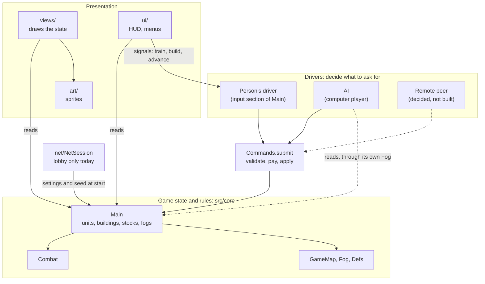

# IMPERIVM — architecture

How the code is put together. For what the game is and what is built, see [`DESIGN.md`](DESIGN.md).

Status key as in DESIGN.md: **built**, **decided**, **proposed**, **open**.

---

## Layout

Code is under `src/`; Godot has no required layout, and scripts find each other by `class_name`, so files
can move between folders freely. Only `res://` paths (the scene, shaders, assets) name locations.

| Folder | Role |
|---|---|
| `src/core/` | The game itself: state and rules (`main`, `unit`, `building`, `combat`, `defs`), the command layer (`commands`), what an order does to a unit (`orders`), where things may go (`placement`, `roads`), founding the players (`world_setup`), the computer players (`ai`), settings, weather, music, and the debug scaffolding (`debug_modes`, `era_preview`). Today `main.gd` is both the simulation and the person's input handling (see *Known debts*). |
| `src/map/` | The ground and what is known of it: `GameMap`, `TerrainGen`, `Fog`, `Iso` (tile/screen maths), `Deposit`. Plain classes that never reference `Main`; they depend only on `GameSettings` and `Defs`. |
| `src/views/` | Drawing the state. Reads the game, never changes it. |
| `src/ui/` | The HUD, menus, lobby, title. Talks to the game through signals and `Main` calls. |
| `src/art/` | Sprite drawing code; baked into PNG sheets by `tools/`. |
| `src/net/` | Lobby networking (`NetSession`). |

### How the parts depend on each other

Arrows mean "calls or reads". (Godot has no module or package concept for GDScript: these boxes are
groups of classes, `class_name` scripts, and the folders are only folders. "Module" in Godot means a
C++ engine extension.)



## Players, drivers and commands  (**built**, except where marked)

The central rule: **a player acts on the game only by submitting a command, and the game cannot tell who
submitted it.**

```
 person (mouse, keys, selection)  ─┐
 AI (computer player)          ─┼─►  Commands.submit(cmd) ─►  game state (units, buildings, stocks)
 remote peer (network)  [decided] ─┤        validate · pay · apply
 replay, test script              ─┘
```

- **Game state** is `Main`'s units, buildings, map, per-player `stocks` and `fogs` (both indexed by owner).
  A player is just an owner number; player 0 is only special in being the one at this keyboard (`Main.LOCAL`).
- **A command** is a plain `Dictionary` of numbers, strings and tiles, with `type` and `owner`; units and
  buildings are named by `id` (`Unit.id`, `Building.id`), never by reference. That makes a command
  serializable, so it can be sent over the network, recorded, or written by hand in a test. The set of
  commands and their fields is listed at the top of `src/core/commands.gd`.
- **`Commands.submit(cmd) -> String`** is the only gate. It checks that the named units and buildings exist
  and belong to `owner` (anything else is trimmed away), checks the rules (affordable, population room,
  placement, era), pays, and applies. It returns `""` on success or a phrase key on refusal (`"err.cant_afford"`; see *Text*), and it never
  touches the selection, mouse, HUD or markers.
- **Drivers** decide what to ask for:
  - The person's driver is the input section of `Main` (`_do`, `_command_at`, `_try_place`, `_train_unit`,
    `_commit_road`, ...). It turns clicks and the selection into commands, flashes a refusal, and keeps
    purely interface state (markers, placement mode, attack-move mode) to itself.
  - `AI` (`src/core/ai.gd`) thinks about once a second and submits commands as its owner through its
    own `_do`. It sees the world through its own `Fog`, so it knows only what its people have seen.
- **What is not a command.** Things the simulation does on its own are not player intent and call the order
  functions directly: a gatherer finding a new tree, a fighter picking a fight (`Combat`), a builder
  finishing and going idle. Scripted setup and the `--showcase`/`--demo` debug modes also place and order
  things directly.

Adding a new action: add a branch in `Commands.submit` and a line in its header comment, make the person's
driver and (if the AI needs it) `AI` call it, and add a case to `tools/commands_test.gd`.

## Time and determinism  (**open**)

The simulation advances in `Main._process(delta)` with real frame time, and uses unseeded randomness in
places (`randf()` in `Unit` and `AI`). It is therefore **not deterministic**. That is fine for one
machine; it decides what multiplayer can be:

- **Host-authoritative** (**proposed**): clients send commands to the host, the host runs the one
  simulation and sends state back. Needs state snapshots, but no determinism.
- **Lockstep** (as in the classic RTS games): every machine runs the same simulation and only commands are
  exchanged. Needs a fixed tick, seeded randomness and no float-order dependence.

Either needs commands applied at a known tick. The command layer is the prerequisite for both, and is done;
the choice between them is not.

## Multiplayer today  (**built**: lobby only)

`NetSession` (`src/net/net_session.gd`, ENet and RPC, a node at `/root/NetSession`) runs the lobby: hosting,
joining, the roster, ready flags, and handing every machine the same settings, world seed and slot. Each
machine then builds the same world. After that **play is not synchronized**; commands are not yet sent
between machines. See DESIGN.md for the lobby itself.

## Known debts

- `Main` (`main.gd`, about 1,500 lines) mixes the simulation (unit movement, gathering, building, combat
  hooks), the person's driver and input, camera, debug modes and startup. The next split is the
  simulation out from the person's driver.
- The era is one value for the whole game and belongs to player 0, so `advance` is refused for other
  players. Eras and the stuff they unlock should be per player.
- The views are still tied to one local viewer in normal play (`game.fog`, "owner 0 is mine"). The spectator
  gets per-AI views with a parallel path (`viewers`, layers) rather than a viewer passed through every view;
  a single `Viewer` object would unify the two.
- Drivers read raw `Main.units` and `Main.buildings`. The `AI` filters by its own fog by discipline, not
  by construction. A per-player view (fog-filtered queries) would enforce it, and is what a remote client
  would receive.
- `Orders`, `Placement`, `Roads` and `Commands` each hold a reference to `Main` and reach back into it for
  state and for pathing (`_set_path` is now `Orders.set_path`, but the movement code is still in `Main`).
  They should depend on a smaller simulation interface once `Main` is split.
- Stock `stock` is still an alias for `stocks[0]`.

## Placement and roads  (**built**)

Two small classes own the ground rules that used to live in `Main`, each holding a reference to `Main`:
`Placement` (`building_at`, `rects`, `find_site`, and `error`, the reason a building can't go on a tile) and
`Roads` (`plans`, the tiles paid for and waiting to be paved and who is on each; `tile_error`,
`assign_work`, `release`, `finish_tile`; and `Roads.line` for dragging out a road). `Commands`, `AI`,
`Combat` and the views call them as `game.placement` and `game.roads`. They still reach back into
`Main` for pathing (`_set_path`) and the world view (`_world`).

## Combat, destruction and victory  (**built**)

`Combat` owns fighting: units attack units, or buildings (`Unit.atk_building`; `order_attack_building`).
Damage to a building goes through `Combat.hurt_building`, and fire (`update_buildings`) is part of the same
rules, not of the views. When a building falls `Main.destroy_building` removes it from the game and emits
`building_destroyed`; the **view** decides how that looks (`World` keeps the burning building up for a few
seconds, then spawns `RuinView` and `RuinFlames`). `Victory` (once a second) decides who is still in the
game and burns the buildings of a people that has fallen. Player actions reach it only through
`Commands` (`attack_building`).

## Scaffolding that is not the game  (**built**)

`DebugModes` (`--demo`, `--showcase`, `--skirmish`, `--town`, ... and the headless `--report`) and
`EraPreview` (the E key, which dresses a fake town for each era) hold code that sets scenes up for looking
at. They are kept out of `Main` so that what is left is the game. `EraPreview.place_display_army` also puts a
few non-population "display" soldiers by the first town in a normal game; it is a placeholder.

## Text  (**built**)

The simulation never produces display text. `Commands`, `Placement`, `Roads` and `Orders` return or pass
**keys** (`err.no_route`), and a client turns a key into words: `Hud.flash_key` looks it up in `Phrases`
(`src/core/phrases.gd`), which holds each message's Latin and English together. That keeps rules separate
from language, so an AI, a test or a remote client can act on a key without parsing a sentence.
Names of buildings, units, resources and eras stay as data in `Defs`; one-word labels and text made up at
the point of use (`"Aetas %s"`, panel readouts) stay where they are drawn. `Latin.t` only applies the
lettering (capitals, V for U). See `LATIN.md` for the vocabulary.

## Watching AIs: the spectator  (**built**)

`just ai4` (or `--spectate`) starts a game with no human: all four players, the first included, are AIs
(`WorldSetup._make_ai`), and the window shows four panes (`src/ui/spectator.gd`).

- **One world, four cameras.** Each pane is a `SubViewport` that shares the main viewport's `World2D`, so
  every pane draws the same scene nodes through its own `Camera2D`. The main window itself draws only
  the panes: its `canvas_cull_mask` is set to a layer the world is not on. The panes render at the screen's
  physical resolution, so the pixel art stays crisp.
- **The views know about several screens.** `World.view_rects()` returns the rectangles being looked at (one
  normally, one per pane when spectating); chunk streaming and unit/building culling use all of them.
- **Each pane shows its own AI's fog.** The AIs' fogs (`Main.fogs[owner]`, the same ones the AIs decide from)
  are drawn, one `FogView` per pane. One scene can look different in each pane through **visibility
  layers**: a pane's `SubViewport` has a cull mask of the shared world (bit 1) plus its own bit
  (`Spectator.pane_bit`). A pane's fog overlay sits only on its bit, and `World` puts each unit and building
  on the bits of the panes whose AI can see it (`_seen_by`, `_explored_by`), so a unit is drawn only where
  that AI sees it. Projectile views are per pane for the same reason. Items inherit "all parents must share
  a layer", so only the top node of a unit or building is set.
- **Each pane has a minimap** (`Minimap` with its own `fog`, `viewer` and outline), inked only where that AI
  has seen. The AIs see little early on, so it starts as a speck around their town.
- **Panes** follow the AI's town, or the army it has sent out (`AI.focus()`); drag to look around, wheel to
  zoom, F to follow again, Q to quit. The text strip is `AI.summary()`: people, villagers, soldiers,
  population, stocks, and what it is doing (a `spec.*` phrase).
- The normal HUD is built but hidden, and input to `Main` is switched off. `Main.fog` (the local player's
  view) is switched to show everything and is not drawn.

## Weather and fog

Weather (`src/core/weather.gd`) is cosmetic: a small state machine that drives `WeatherView`, the ground
shading and the music's mood. It does not affect play, and is not worth a module of its own. Fog (`Fog`,
in `src/map/`) is different: it is per-player simulation state (`Main.fogs`, by owner) that the AI and
`Commands` read to decide what a player may see, explore and build on. `FogView` only draws it.

## Tests

- `just commands-test`: boots a real two-player game headless and submits commands: ownership, payment,
  refusals, orders.
- `just phrases-test`: every phrase has Latin and English, and every key named in the code exists.
- `just siege-test`: attacking, burning and destroying a building, a people being defeated, and the last one winning.
- `just war-test`: an AI wave marches across the map, burns the enemy town down and defeats the people.
- `just net-test`: the lobby, host and client in two processes.
- `--report` (see the justfile): runs a game headless and dumps the state, which is how AI behavior is
  checked.
