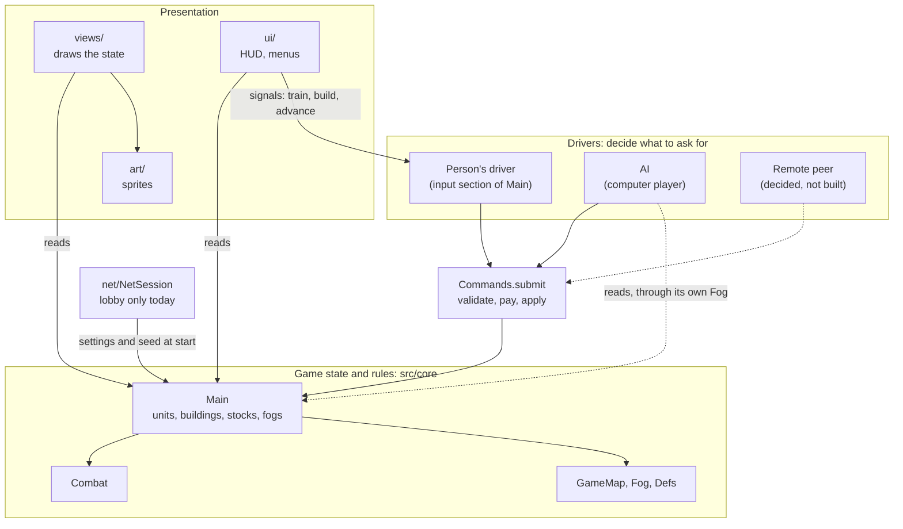

# IMPERIVM — architecture

How the code is put together. For what the game is and what is built, see [`DESIGN.md`](DESIGN.md).

Status key as in DESIGN.md: **built**, **decided**, **proposed**, **open**.

---

## Layout

Code is under `src/`; Godot has no required layout, and scripts find each other by `class_name`, so files
can move between folders freely. Only `res://` paths (the scene, shaders, assets) name locations.

| Folder | Role |
|---|---|
| `src/core/` | The game itself: state, rules, the map, the command layer, the computer players. Today `main.gd` is both the simulation and the person's input handling (see *Known debts*). |
| `src/views/` | Drawing the state. Reads the game, never changes it. |
| `src/ui/` | The HUD, menus, lobby, title. Talks to the game through signals and `Main` calls. |
| `src/art/` | Sprite drawing code; baked into PNG sheets by `tools/`. |
| `src/net/` | Lobby networking (`NetSession`). |

### How the parts depend on each other

Arrows mean "calls or reads". (Godot has no module or package concept for GDScript: these boxes are
groups of classes, `class_name` scripts, and the folders are only folders. "Module" in Godot means a
C++ engine extension.)



## Players, drivers and commands  (**built**, except where marked)

The central rule: **a player acts on the game only by submitting a command, and the game cannot tell who
submitted it.**

```
 person (mouse, keys, selection)  ─┐
 AI (computer player)          ─┼─►  Commands.submit(cmd) ─►  game state (units, buildings, stocks)
 remote peer (network)  [decided] ─┤        validate · pay · apply
 replay, test script              ─┘
```

- **Game state** is `Main`'s units, buildings, map, per-player `stocks` and `fogs` (both indexed by owner).
  A player is just an owner number; player 0 is only special in being the one at this keyboard (`Main.LOCAL`).
- **A command** is a plain `Dictionary` of numbers, strings and tiles, with `type` and `owner`; units and
  buildings are named by `id` (`Unit.id`, `Building.id`), never by reference. That makes a command
  serializable, so it can be sent over the network, recorded, or written by hand in a test. The set of
  commands and their fields is listed at the top of `src/core/commands.gd`.
- **`Commands.submit(cmd) -> String`** is the only gate. It checks that the named units and buildings exist
  and belong to `owner` (anything else is trimmed away), checks the rules (affordable, population room,
  placement, era), pays, and applies. It returns `""` on success or a Latin reason on refusal, and it never
  touches the selection, mouse, HUD or markers.
- **Drivers** decide what to ask for:
  - The person's driver is the input section of `Main` (`_do`, `_command_at`, `_try_place`, `_train_unit`,
    `_commit_road`, ...). It turns clicks and the selection into commands, flashes a refusal, and keeps
    purely interface state (markers, placement mode, attack-move mode) to itself.
  - `AI` (`src/core/ai.gd`) thinks about once a second and submits commands as its owner through its
    own `_do`. It sees the world through its own `Fog`, so it knows only what its people have seen.
- **What is not a command.** Things the simulation does on its own are not player intent and call the order
  functions directly: a gatherer finding a new tree, a fighter picking a fight (`Combat`), a builder
  finishing and going idle. Scripted setup and the `--showcase`/`--demo` debug modes also place and order
  things directly.

Adding a new action: add a branch in `Commands.submit` and a line in its header comment, make the person's
driver and (if the AI needs it) `AI` call it, and add a case to `tools/commands_test.gd`.

## Time and determinism  (**open**)

The simulation advances in `Main._process(delta)` with real frame time, and uses unseeded randomness in
places (`randf()` in `Unit` and `AI`). It is therefore **not deterministic**. That is fine for one
machine; it decides what multiplayer can be:

- **Host-authoritative** (**proposed**): clients send commands to the host, the host runs the one
  simulation and sends state back. Needs state snapshots, but no determinism.
- **Lockstep** (as in the classic RTS games): every machine runs the same simulation and only commands are
  exchanged. Needs a fixed tick, seeded randomness and no float-order dependence.

Either needs commands applied at a known tick. The command layer is the prerequisite for both, and is done;
the choice between them is not.

## Multiplayer today  (**built**: lobby only)

`NetSession` (`src/net/net_session.gd`, ENet and RPC, a node at `/root/NetSession`) runs the lobby: hosting,
joining, the roster, ready flags, and handing every machine the same settings, world seed and slot. Each
machine then builds the same world. After that **play is not synchronized**; commands are not yet sent
between machines. See DESIGN.md for the lobby itself.

## Known debts

- `Main` (`main.gd`, about 2,400 lines) mixes the simulation (unit movement, gathering, building, combat
  hooks), the person's driver and input, camera, debug modes and startup. The next split is the
  simulation out from the person's driver.
- The era is one value for the whole game and belongs to player 0, so `advance` is refused for other
  players. Eras and the stuff they unlock should be per player.
- Drivers read raw `Main.units` and `Main.buildings`. The `AI` filters by its own fog by discipline, not
  by construction. A per-player view (fog-filtered queries) would enforce it, and is what a remote client
  would receive.
- `Commands` calls `Main`'s underscore order functions (`_order_move`, `_order_gather`, ...); they are
  `Main`'s private rules for what an order does, and should move with the simulation when it is split out.
- Stock `stock` is still an alias for `stocks[0]`.

## Tests

- `just commands-test`: boots a real two-player game headless and submits commands: ownership, payment,
  refusals, orders.
- `just net-test`: the lobby, host and client in two processes.
- `--report` (see the justfile): runs a game headless and dumps the state, which is how AI behavior is
  checked.
